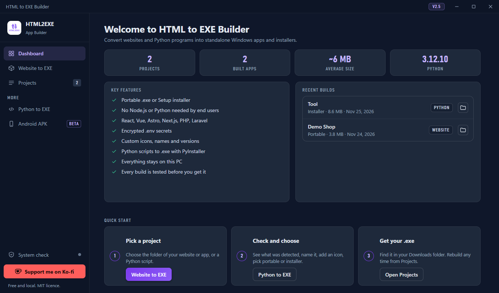
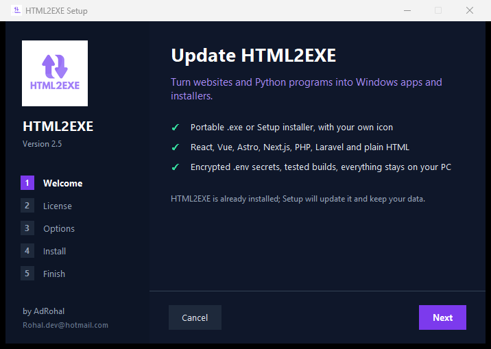
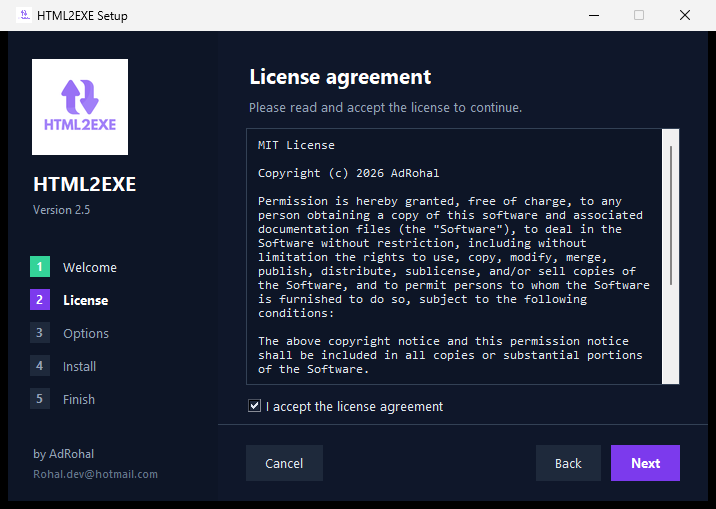
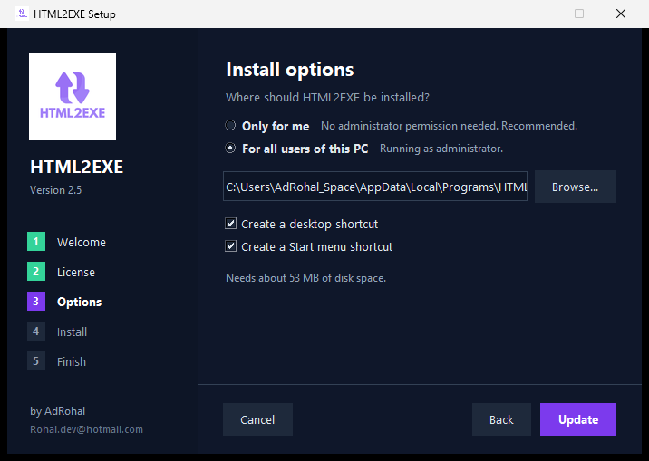
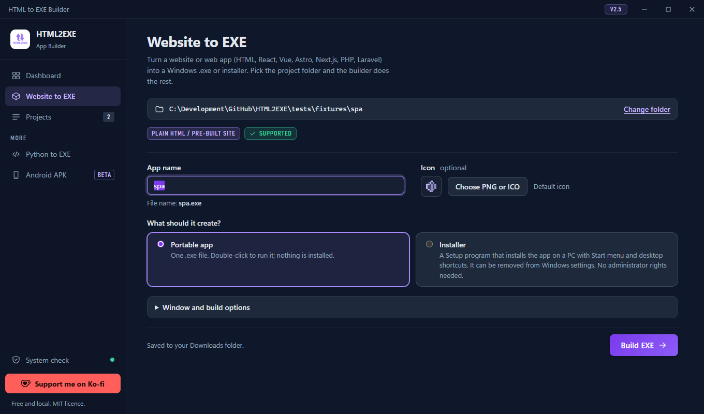
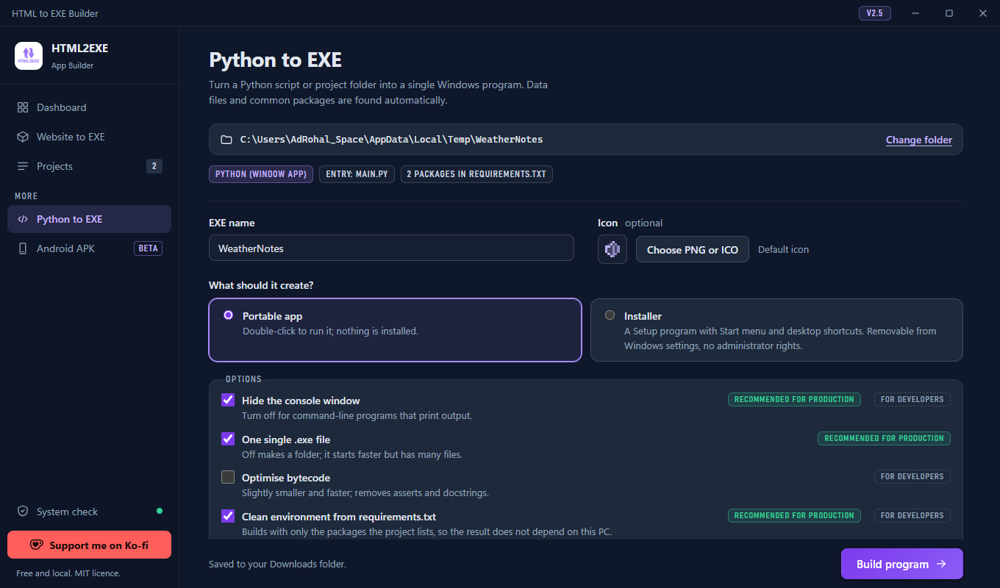
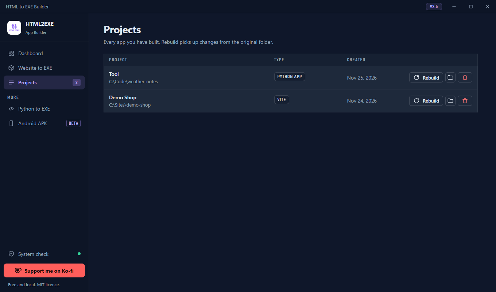
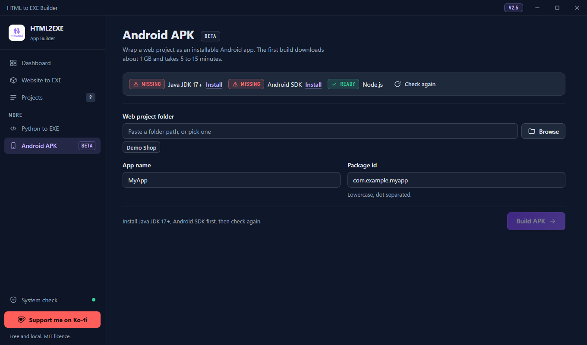

<div align="center">


# HTML2EXE

**Turn websites and Python programs into Windows apps and installers. No command line needed.**

[](https://github.com/AdRohal/HTML2EXE/releases)
[](#requirements)
[](./LICENSE)
[](https://ko-fi.com/adrohal)

[**Download the installer**](https://github.com/AdRohal/HTML2EXE/releases) · [Run from source](#run-it-from-the-source-code) · [Roadmap](./docs/ROADMAP.md) · [Support on Ko-fi](https://ko-fi.com/adrohal)



</div>

---

## What it does

HTML2EXE is a desktop app. You pick a folder, it works out what is inside, and it gives you a finished Windows program: a single portable `.exe`, or a `Setup.exe` installer.

| Tool | What you give it | What you get | Status |
|---|---|---|---|
| **Website to EXE** | A website or web app: plain HTML, React, Vue, Svelte, Astro, Next.js, Nuxt, Angular, Gatsby, SvelteKit, a Node project with a build script. PHP and Laravel (experimental) | A portable `.exe` or an installer. People who run it need nothing installed | Ready |
| **Python to EXE** | A Python script or project folder | A portable `.exe` / folder, or an installer | Ready |
| **Website to Android (APK)** | A web project | An installable `.apk` (using Capacitor) | **Under work (beta)** |

Everything runs on your PC. Nothing is uploaded anywhere.

---

## Download and install

1. Open the [**Releases**](https://github.com/AdRohal/HTML2EXE/releases) page and download `HTML2EXE-Installer-V2.5.exe`.
2. Run it. The wizard shows the license, then asks where to install:
   - **Only for me** (recommended): no administrator permission needed.
   - **For all users of this PC**: Windows asks for administrator permission and it installs to `Program Files`.
3. Start **HTML2EXE** from the Start menu or the desktop shortcut.

<p align="center">
  
  
  
</p>

To remove it: Windows **Settings > Apps**, or run `HTML2EXE.exe --uninstall`.

> **Check your download (optional).** Each release has a `.sha256` file. In PowerShell: `Get-FileHash .\HTML2EXE-Installer-V2.5.exe -Algorithm SHA256`, then compare it with the file.
>
> **SmartScreen.** The installer is not code-signed, so Windows may say "unknown publisher". Choose *More info > Run anyway*. Signing needs a paid certificate.

### Requirements

| To... | You need |
|---|---|
| Run HTML2EXE | Windows 10 or 11 (64-bit) and the WebView2 runtime (already on current Windows) |
| Build apps | **Python 3.10+** (tested on 3.12) with `pip install pyinstaller pywebview Pillow cryptography`, because HTML2EXE packages with PyInstaller. The **System check** page shows what is missing |
| Build React, Vue, Next.js... | **Node.js 18+** |
| Make nicer installers (optional) | [Inno Setup 6](https://jrsoftware.org/isdl.php). Without it the built-in installer is used |
| Build Android apps (beta) | JDK 17+, Android SDK, Node.js |
| Run the apps you make | Nothing |

---

## How to use it

### 1. Website to EXE

Pick the project folder (or paste its path). HTML2EXE detects the framework, builds it when needed (`npm install` and the build script), tests the result and packs it.



- **Portable or installer.** A portable app is one `.exe` file; an installer adds Start menu and desktop shortcuts, appears in Windows Apps and can be removed cleanly. Version and publisher are set here.
- **Icon.** Leave it empty and HTML2EXE looks for your site's icon: `<link rel="icon">`, the web manifest, `favicon`, `logo`, `apple-touch-icon`... It shows what it found. You can remove it or choose your own PNG or ICO.
- **Window options.** Size, resizable, full screen. Next.js can be a static export or a server app (see below).
- **Your original folder is never changed.** Builds use a temporary copy that is deleted afterwards.

### 2. Python to EXE



- It reads the project first: entry point (`main.py`, `app.py`... or a file with `if __name__ == "__main__"`), window app or command-line, `requirements.txt`, data files.
- **Clean environment**: with a `requirements.txt` the program is built in its own virtual environment, so it only contains what the project lists.
- Options: one file or one folder, hide the console, optimized bytecode, administrator prompt, hidden imports, version info in the file's Properties.
- Options that only matter to developers carry a **For developers** tag, and the safe defaults carry **Recommended for production**.
- A `.env` file is never bundled.

### 3. Projects and Dashboard

Every build is remembered. **Projects** lets you rebuild after changing your code, open the folder or delete the project. The **Dashboard** shows your numbers (projects, built apps, average size) and your latest builds.



### 4. System check

Shows which tools this PC has (Python, PyInstaller, Node.js, Inno Setup, WebView2, Java, Android SDK), what each one unlocks, and links to get what is missing.

---

## Website to Android (APK): under work



This tool is in **beta** and still being worked on.

| Works | Still under work |
|---|---|
| Plain HTML/CSS/JS and React/Vue projects wrapped with Capacitor into a debug `.apk` | Next.js and Angular projects |
| Prerequisite check (JDK, Android SDK, Node.js) | Release-signed APKs and Play Store bundles |
| Live build log and cancel | Custom icons and splash screens |
| | Faster first build (it downloads about 1 GB of Gradle files) |

APKs are static sites: a site that needs its own backend or API routes will not work inside one.

---

## Apps with API routes and secrets (`.env.local`)

A Next.js app with API routes needs a server, so HTML2EXE builds a **server app**: Next's standalone output plus the Node.js runtime, started on a free `127.0.0.1` port and shown in the same window.

If the project has `.env.local` (or `.env`, `.env.production`...), the build screen lists the variables by **name, kind and length only**. Values are never shown, logged, or written into project files. You choose:

| Choice | What happens |
|---|---|
| **Encrypt and bundle** (default) | AES-256-GCM encrypted inside the `.exe`, decrypted in memory when the app starts |
| **Do not bundle** | Nothing secret in the `.exe`; each user adds their own `.env` in the app's data folder (`%LOCALAPPDATA%\H2E-<app>\.env`) |

The build redacts secrets in the log and scans the built files for leaked values. `NEXT_PUBLIC_*`, `VITE_*` and similar variables are public by design.

**Be honest about the limits.** Encryption stops copying and text searches. It cannot stop someone who reverse-engineers the `.exe`, because a program that decrypts its own secrets can be made to show them. Fine for keys you can rotate or apps you share with people you trust. Do not ship database passwords or private keys to strangers: keep those on a server.

---

## Run it from the source code

```powershell
git clone https://github.com/AdRohal/HTML2EXE.git
cd HTML2EXE
python -m venv .venv
.venv\Scripts\Activate.ps1
pip install -r requirements.txt
python builder.py
```

`requirements.txt` installs `pywebview`, `pyinstaller`, `Pillow` and `cryptography`.

**Run the tests**

```powershell
python -m unittest discover -s tests            # fast unit tests (about 155)
python tests/e2e_python.py                      # slow: real Python build
python tests/e2e_python_installer.py builtin    # slow: build, install, run, uninstall (or: inno)
```

**Build the release installer** (this makes `release/HTML2EXE-Installer-V<version>.exe` and its `.sha256`):

```powershell
python tools/build_release.py
```

It packs HTML2EXE without `tests/`, `docs/` or tooling folders and wraps it in the branded installer. The version comes from `APP_VERSION` in `h2e/dashboard.py`.

**Project layout**

```
builder.py            window + local API (token protected)
builder_ui/           the interface (index.html, style.css, app.js, assets)
h2e/
  exe_build.py        website -> EXE pipeline
  recipes.py          framework detection and builds (npm, Next.js, PHP)
  python_builder.py   Python -> EXE
  installer.py        installers: Inno Setup and the built-in branded wizard
  secrets.py          .env encryption (AES-256-GCM) and leak scan
  iconfinder.py       finds the icon of a project
  workspace.py        temporary working copies and caches
  jobs.py             background jobs, live log, cancel
  dashboard.py        numbers for the dashboard
  android_builder.py  Android (Capacitor), beta
tests/                unit tests and slow end-to-end scripts
tools/build_release.py
docs/                 roadmap and screenshots
```

---

## Releases

| Version | Highlights |
|---|---|
| **V2.5** (current) | New dashboard, Website to EXE and Python to EXE redesigned, portable or installer for both, Next.js server mode with encrypted `.env`, automatic icon detection, branded installer with license, per-user or all-users install |

All versions are on the [Releases](https://github.com/AdRohal/HTML2EXE/releases) page. Planned work is in the [roadmap](./docs/ROADMAP.md).

---

## Where files go

| What | Where |
|---|---|
| Finished `.exe` / `Setup.exe` | `Downloads\` |
| Project list and settings | `Documents\HTML2EXE\<project>\` |
| Build caches (`node_modules`, Python environments) | `Documents\HTML2EXE\<project>\cache\` |
| Temporary working copy while building | `Downloads\<project>\`, deleted when the build ends |
| Android builds (beta) | `Documents\HTML2EXE_Android\<app>\` |
| A built app's saved data | `%LOCALAPPDATA%\H2E-<app>\` |

---

## Troubleshooting

| Problem | What to do |
|---|---|
| A tool shows as missing | Open **System check**; each row has a link to get it |
| Python build: a module is missing in the `.exe` | Add it to `requirements.txt` or list it under hidden imports; the build log names modules PyInstaller could not find |
| Antivirus flags a built `.exe` or Setup | Unsigned programs are sometimes flagged by heuristics. Install Inno Setup for installers, and add an exception for your own builds |
| "The requested operation requires elevation" | Fixed in V2.5: the installer now starts the app through Windows so the administrator prompt appears |
| Android: `JAVA_HOME` or SDK not found | Install Android Studio, or set `JAVA_HOME` / `ANDROID_HOME` |
| First Android build takes very long | It downloads about 1 GB; this is normal |

---

## Support the project

HTML2EXE is free and built by one person. If it saves you time, you can buy me a coffee.

<p align="center">
  <a href="https://ko-fi.com/adrohal"></a>
</p>

---

## Author and license

Made by **AdRohal** · [ko-fi.com/adrohal](https://ko-fi.com/adrohal) · [Rohal.dev@hotmail.com](mailto:Rohal.dev@hotmail.com)

Released under the [MIT License](./LICENSE).
