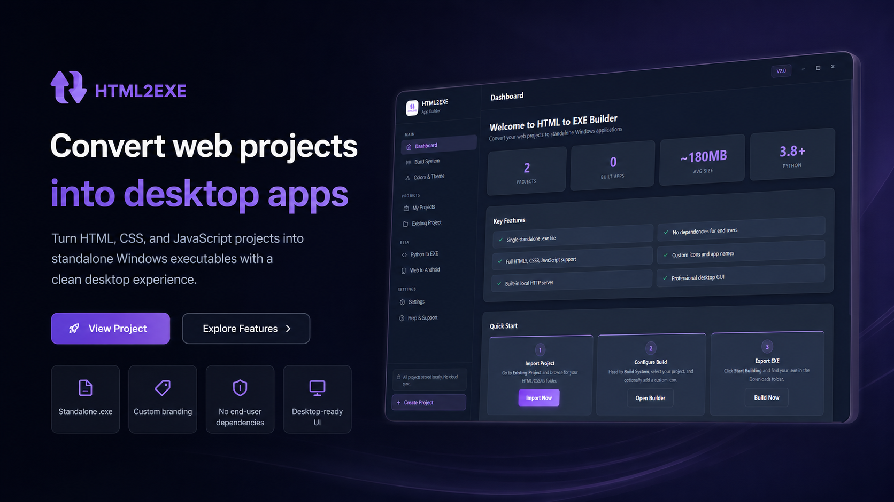

# HTML to EXE Builder



A professional desktop application that converts **HTML/CSS/JavaScript** web projects into Windows `.exe` desktop apps, **Python** scripts into standalone executables, and **web frameworks** into Android APKs. No coding or command-line knowledge required — everything is done through a sleek graphical interface.


---

## What Does This App Do?

- **HTML to EXE** — Take any web project (HTML, CSS, JavaScript, or a React / Vue / Astro / Next.js / Nuxt project; PHP and Laravel are experimental) and package it as a native Windows desktop application (`.exe`). Users can run it without a browser, without a web server, without anything installed.
- **Python to EXE** *(Beta)* — Convert Python scripts and projects into standalone `.exe` files. End users don't need Python installed on their machine.
- **Web to Android APK** *(Beta)* — Convert HTML, React, Vue, and other web projects into native Android APK files. Works best with plain HTML/CSS/JS and React projects.

---

## Features

| Feature | Description |
|---------|-------------|
| **Single `.exe` output** | Everything bundled into one file — just share it |
| **No dependencies for end users** | Recipients don't need Python, Node.js, or anything else |
| **Custom app icon** | Upload a `.png` or `.ico` file as your app icon |
| **Project management** | Create, import, and organize multiple projects |
| **Framework detection** | Auto-detects React, Vue, Angular, jQuery, Svelte, Bootstrap, Tailwind, Next.js, etc. |
| **Python to EXE (Beta)** | Convert Python projects with auto-detected imports and data files |
| **Web to Android APK (Beta)** | Convert web projects to native Android APKs using Capacitor |
| **Professional GUI** | Modern, frameless dark-themed desktop interface built with PyWebView |
| **Color & Theme panel** | Manage and explore color palettes for your projects |

---

## System Requirements

### To Run the Builder App (Developer Machine)

| Requirement | Details |
|-------------|---------|
| **Operating System** | Windows 10 or Windows 11 (64-bit) |
| **Python** | Version **3.8 to 3.12** recommended. Python 3.13+ works but requires PyInstaller 6.10+ |
| **pip** | Python package manager (included with Python) |
| **Disk Space** | ~500 MB free (for Python packages and build output) |
| **RAM** | 4 GB minimum, 8 GB recommended |
| **Internet** | Required only for initial package installation |

### For Android APK Building (Web to Android)

These are **optional** — only needed if using the Web to Android feature:

| Requirement | Details |
|-------------|---------|
| **Java Development Kit (JDK)** | Java 17–24 (bundled with Android Studio JBR is auto-detected) |
| **Android SDK** | Installed at `%LOCALAPPDATA%\Android\Sdk` (Android Studio handles this) |
| **Node.js** | v18+ (required for npm and web framework builds) |
| **Gradle** | Auto-downloaded on first build (~500 MB) |

> **Tip:** Install [Android Studio](https://developer.android.com/studio) for the easiest setup. It includes JDK, SDK, and Gradle. The builder auto-detects these.

### For End Users (Running the Generated Files)

| File Type | Requirements |
|-----------|--------------|
| **Windows `.exe`** | Windows 10+ (64-bit) — no Python, no install needed |
| **Android `.apk`** | Android 6.0+ device — install like any app |
| **Python `.exe`** | Windows 10+ (64-bit) — no Python, no install needed |

---

## Installation

### 1. Clone the Repository

```bash
git clone https://github.com/AdRohal/HTML2EXE.git
cd HTML2EXE
```

### 2. Create a Virtual Environment (Recommended)

```bash
python -m venv .venv
```

Activate it:

```powershell
# Windows PowerShell
.venv\Scripts\Activate.ps1

# Windows CMD
.venv\Scripts\activate.bat
```

### 3. Install Dependencies

```bash
pip install -r requirements.txt
```

This installs:
- **pywebview** (>= 5.0) — Desktop GUI framework (renders the HTML interface)
- **pyinstaller** (>= 6.10) — Packages Python apps into standalone executables
- **Pillow** (>= 10.0) — Image processing (converts PNG icons to ICO format)

### 4. Run the App

```bash
python builder.py
```

The builder GUI will open automatically.

---

## How to Use

### Converting HTML to EXE

1. Open the app (`python builder.py`). **Dashboard** is the first screen (counts, recent builds, quick start); **Website to EXE** builds websites.
2. Click **Browse for folder** (or paste a path and press Enter). Pick the folder that holds your `index.html`, or your React / Vue / Astro / Next.js / Nuxt / Angular / SvelteKit / PHP / Laravel project.
3. Check what was detected, set the app name, and optionally an icon and window size. Choose what to create: a **portable app** (one .exe) or an **installer** (see below).
4. Click **Build EXE** (or **Build installer**). A strip of steps (Prepare, Build site, Package, Verify) shows progress with a live log and a Cancel button.
5. The result is saved to your **Downloads** folder, and the builder checks it before reporting success (the .exe is started once; an installer verifies its own contents). **Open folder** takes you there. Downloads contains only the finished file: the temporary working copy the build used is deleted.

Built apps are listed under **Projects**, where **Rebuild** picks up changes from the original folder with one click.

### Converting Python to EXE (Beta)

1. Open the app (`python builder.py`)
2. Go to **Python to EXE** in the sidebar
3. Click **Browse** and select your Python script or project folder
4. Set the executable name and optional icon
5. Configure options (hide console, single file, etc.)
6. Click **Convert to EXE**
7. Your `.exe` will be saved to your **Downloads** folder

> **Tip:** Your Python project should have a `main.py`, `app.py`, or `run.py` as the entry point. If none of these exist, the first `.py` file found will be used.

### Converting Web to Android APK (Beta)

1. Open the app (`python builder.py`)
2. Go to **Android APK** in the sidebar
3. Check the prerequisites strip: Java, Android SDK and Node.js should all say Ready (the build button stays off until they do)
4. Under **Web project folder**, browse to your project (HTML, React, Vue, etc.) or pick a recent one
5. Fill in package name (e.g., `com.example.myapp`) and app name
6. Click **Build APK**
7. The builder will:
   - Detect your framework (plain HTML, React, Vue, etc.)
   - Build the web project (if needed)
   - Initialize Capacitor and Gradle
   - Compile the APK
8. Your `.apk` file will be saved to `Documents\HTML2EXE_Android\<app_name>\android\app\build\outputs\apk\debug\`

> **Note:** The first APK build takes **5–15 minutes** — Gradle downloads 1+ GB of dependencies. Subsequent builds are faster.

### Windows EXE Support Matrix

Every row below is covered by an automated build in `tests/` (real `npm` build, real PyInstaller EXE, then the EXE is started and probed).

| Project type | Status | What happens |
|--------------|--------|--------------|
| **Plain HTML/CSS/JS** | Supported | Bundled as-is |
| **Vite** (React, Vue, Svelte, Solid, Preact) | Supported | `npm install` + `npm run build`, serves `dist/` |
| **Create React App** | Supported | `npm run build`, serves `build/` |
| **Astro** (static output) | Supported | `npm run build`, serves `dist/`. SSR (`output: 'server'`) is rejected with an explanation |
| **Next.js** (no server code) | Supported | `output: 'export'` is applied temporarily (works with `next.config.js`, `.mjs`, `.cjs` and `.ts`) and your config is restored afterwards |
| **Next.js with API routes / route handlers / middleware** | Supported (server mode) | Built with `output: 'standalone'` and packed together with the Node.js runtime; the .exe starts its own local server on `127.0.0.1` (adds about 90 MB). Secrets from `.env.local` are encrypted, see below |
| **Nuxt 3** | Supported | `nuxt generate`, serves `.output/public` |
| **Angular** (17+/18 `application` builder) | Supported | `ng build`, serves `dist/<name>/browser` |
| **Gatsby 5** | Supported | `gatsby build`, serves `public/` |
| **SvelteKit 2 and 3** | Supported | Needs `@sveltejs/adapter-static` (set in `svelte.config.js`, or in the `sveltekit()` plugin options for SvelteKit 3) and `export const prerender = true` |
| **PHP** (plain) | Experimental | A portable PHP is downloaded once and bundled into the EXE |
| **Laravel** | Experimental | Needs `vendor/` (or Composer installed). SQLite database and `.env` are created per user in `%LOCALAPPDATA%` |

Generated apps handle client-side routing (React Router, Vue Router history mode, `/about` -> `about.html`) and check for the WebView2 runtime on start-up.

### Web to Android Support Matrix

| Framework | Status | Notes |
|-----------|--------|-------|
| **Plain HTML/CSS/JS** | ✅ Fully Supported | Works perfectly |
| **React (Vite, Create React App)** | ✅ Fully Supported | Detects and builds automatically |
| **Vue (Vite)** | ✅ Fully Supported | Works out of the box |
| **Svelte / SvelteKit** | ✅ Fully Supported | Builds to static site |
| **Angular** | 🚧 In Development | API routes block static export; need workaround |
| **Next.js 13+ (App Router)** | 🚧 In Development | API routes / dynamic routes require stubbing; fallback uses `.next/server/app` |
| **Nuxt 3** | ⚠️ Experimental | Should work; not fully tested |
| **Gatsby** | ⚠️ Experimental | Limited testing |

> **Limitations:** 
> - No server-side features (API routes, SSR, form submission to backend)
> - No external API calls (CORS blocks requests)
> - localStorage and sessionStorage work fine
> - Web Workers and Service Workers untested

---

## What Works in the Generated Files


### HTML to EXE & Web to Android APK

| Supported | Not Supported |
|-----------|---------------|
| HTML5 / CSS3 | Node.js / npm modules |
| Vanilla JavaScript | Back-end servers / API routes |
| DOM manipulation | Electron-specific APIs |
| Canvas & SVG | Direct file system access (except Android storage) |
| localStorage API | CORS-blocked external API calls |
| sessionStorage API | Server-side rendering (SSR) |
| Fetch API (local) | WebSockets |
| ES6+ features | Backend form submission |
| React, Vue, Svelte | External CDN resources (must be bundled) |
| CSS animations & transitions | Plugins that require server |

> **For Android:** Capacitor provides limited file system and device access APIs. Most web projects work unchanged, but server-dependent features won't function without a backend.

### Building the release installer

`python tools/build_release.py` creates `release/HTML2EXE-Installer-V<version>.exe` (+ a `.sha256` file) for GitHub Releases. It packs HTML2EXE without `tests/`, `docs/`, project notes or tooling folders, and wraps it in the branded installer (license page, per-user or all-users install, Ko-fi button). The version comes from `h2e/dashboard.py` (`APP_VERSION`). The installer is unsigned, so Windows SmartScreen may show a warning until it has a reputation.

## Python to EXE

| Supported | Notes |
|-----------|-------|
| Standard Python scripts | Auto-detects entry point |
| Third-party packages | Auto-detected from imports |
| Data files (JSON, YAML, CSV, etc.) | Bundled automatically |
| GUI frameworks (tkinter, PyQt, etc.) | Works out of the box |
| Web frameworks (Flask, Django) | Requires proper configuration |

---

## Project Structure

```
HTML2EXE/
├── builder.py              # App entry point: local HTTP API handler + builder window
├── h2e/                    # Build engine (one module per concern)
│   ├── recipes.py          # Detect framework -> install -> build -> find output (Vite, CRA, Astro,
│   │                       #   Next.js, Nuxt, Angular, Gatsby, SvelteKit, PHP, Laravel)
│   ├── exe_build.py        # Packs a site/PHP app into an EXE with PyInstaller + self-test
│   ├── launcher.py         # Code embedded in every generated EXE (SPA server, PHP, WebView2 check)
│   ├── php_runtime.py      # Downloads/caches a portable PHP for PHP and Laravel apps
│   ├── python_builder.py   # Python script/project -> EXE
│   ├── android_builder.py  # Web project -> Android APK (Capacitor)
│   ├── analyzer.py         # Looks at a folder and guesses the project type
│   ├── installer.py        # Builds <App>-Setup.exe (wizard, silent mode, hash check, Apps & features entry)
│   ├── workspace.py        # Temporary working copy in Downloads: create, park caches, delete safely
│   ├── winshell.py         # Desktop / Start menu folders (shared by installer and installed app)
│   ├── secrets.py          # .env files: parse, classify, AES-256-GCM encrypt, log redaction helpers, leak scan
│   ├── templates.py        # Starter projects for "Create project"
│   ├── jobs.py             # Background jobs: live log, Cancel, streamed subprocesses
│   ├── security.py         # API token, Origin/Host checks, safe ids and paths
│   └── syscheck.py         # "System Check" page data
├── builder_ui/             # Frontend: index.html, style.css, app.js (no framework, no build step)
├── tests/                  # Unit tests (python -m unittest discover -s tests)
│   └── e2e_*.py            # Slow real-build tests (need internet / Node), see their docstrings
├── docs/ROADMAP.md         # Audit and phased plan
├── requirements.txt
└── LICENSE                 # MIT
```

---

## Portable app or installer

On the Build screen you choose what the build produces:

| | Portable app | Installer |
|---|---|---|
| File | `<App>.exe` | `<App>-Setup.exe` |
| Use | Double-click to run. Nothing is installed. | Installs the app on a PC. |
| Shortcuts | none | Start menu and desktop (the person installing can untick them) |
| Removal | delete the file | Windows settings, Apps (or `<App>.exe --uninstall`) |

Two installer engines, chosen automatically:

| Engine | When | Notes |
|---|---|---|
| **Inno Setup 6** (preferred) | `ISCC.exe` is installed (free, https://jrsoftware.org/isdl.php; shown on the System check page) | The Windows standard: native look, and antivirus programs rarely flag it. Silent install: `Setup.exe /VERYSILENT`. |
| **Built-in installer** | Inno is not installed | Works with nothing extra. It is a small generated program, and unsigned programs like it are sometimes flagged by antivirus *heuristics* (false positives). The builder never uses hidden PowerShell or other malware-like tricks in it, but if you ship installers to other people, install Inno Setup. Silent install: `Setup.exe /S`. |

Both are per-user and add the app to Windows' Apps list. What the built-in installer does in detail (Inno does the equivalent):

- **Per user, no administrator rights.** Default folder `%LOCALAPPDATA%\Programs\<App>`; the person can pick another.
- **Wizard or silent.** `<App>-Setup.exe /S` installs silently; add `/D=C:\some\folder`, `--no-desktop`, `--no-startmenu`, `--launch`.
  Exit code 0 means success, 1 failure; a log is written to `%TEMP%\<App>-setup.log`.
- **Checks itself.** The installer verifies the SHA-256 of the app inside it while copying; a damaged download refuses to
  install and leaves nothing behind. The builder also runs this check before it reports success.
- **Shows up in Apps & features** with name, version and publisher (set both in the build options, version like `1.0.0`).
- **Updates in place.** Running a newer Setup over an existing install replaces the app and keeps the user's own data.
  If the app is running, Setup asks to close it instead of failing half-way.
- **Uninstalls cleanly.** Removes the shortcuts, the Apps & features entry and the program folder; asks whether to also
  delete the app's saved data (`%LOCALAPPDATA%\H2E-<App>`). It only ever deletes the folder Windows has registered for
  the app, so a copy of the app run from somewhere else refuses to remove anything.

Windows may show a SmartScreen "unknown publisher" warning for any program that is not code-signed, installer or not.
Signing needs a certificate and is not part of HTML2EXE.

---

## Apps with API routes and secrets (`.env.local`)

A Next.js app that has API routes (or route handlers, middleware, server components that call APIs) needs a
server. HTML2EXE detects this and builds a **server app**: Next's standalone output plus the Node.js runtime,
started on a free `127.0.0.1` port when the .exe opens and shown in the same window.

If the project has `.env.local` (or `.env`, `.env.production`, `.env.production.local`, loaded in Next's order),
the Build screen lists the variables by **name, kind and length only**. Values are never shown on screen, never
logged, and never stored in project files. You choose what to ship:

| Choice | What happens |
|--------|--------------|
| **Encrypt and bundle** (default) | Values are encrypted with AES-256-GCM and stored inside the .exe. The app decrypts them **in memory** when it starts and hands them to its server through the process environment. The data is bound to that exact build and a modified file refuses to decrypt. |
| **Do not bundle** | Nothing secret is stored in the .exe. Each person puts their own keys in a `.env` file in the app's data folder (`%LOCALAPPDATA%\H2E-<app name>\.env`). |

A `.env` file in that data folder also overrides bundled values with either choice.

How the secrets are kept out of harm's way during the build:

- Env files are read from your **original** folder and given to `npm run build` through its environment (the way a
  shell would). They are not copied into the working copy, the staged bundle or the .exe, and any copy left by an
  older version is deleted from the working copy.
- Secret values are redacted (`***`) in the live log, the copied log and error messages.
- Before packaging, the builder **scans the built files** for the exact text of every secret. If one is found
  (for example in a prerendered page or an inlined constant), the finished screen warns you by name.
- `NEXT_PUBLIC_*` (and `VITE_*`, `REACT_APP_*` ...) variables are public by design: the framework writes them into
  the page. They are marked *Public* and are not treated as secrets.

**What this does and does not protect.** Encryption stops people from copying values out of the file, from
searching it for text, and from reading it with a hex editor. It cannot stop someone who reverse-engineers the
.exe, because any program that can decrypt its own secrets can be made to show them (the key must travel with the
program). So:

- Fine for keys you can rotate, or for an app you only run yourself or share with people you trust.
- Not fine for database passwords or private keys in an app you hand to strangers. Put those on a server and let the
  app call that server, or use **Do not bundle** and give every user their own credentials.
- The local server listens on `127.0.0.1` only, but any program on the same PC can reach that port while the app runs.

---

## Python to EXE

Pick a script or project folder. The builder analyses it first (entry point, window app or command-line, `requirements.txt`, data files) and then builds:

- **Portable or installer**: one `.exe` / one folder, or a `Setup.exe` (Inno Setup when installed, otherwise the built-in installer) with version and publisher. Installed programs remove themselves with `App.exe --uninstall`, and appear in Windows Apps.
- **Clean environment**: with a `requirements.txt` the project gets its own cached virtual environment, so the result only contains what the project lists. Turn it off to build with this PC's Python.
- **Icon** (PNG or ICO), version details in the file's Properties, optional administrator prompt, optimised bytecode, hidden imports.
- A `.env` file is never bundled. Missing modules found in PyInstaller's warnings are reported after the build.
- Bulky build folders are deleted afterwards; the project is saved under **Projects** so it can be rebuilt.

Tests: `python tests/e2e_python.py` and `python tests/e2e_python_installer.py [builtin|inno]` (real build, silent install, run, uninstall).

## Storage Locations

| What | Where |
|------|-------|
| Project metadata | `Documents\HTML2EXE\<project_name>\project.json` |
| Temporary working copy of your project | `Downloads\<project_name>\` while building, **deleted when the build ends** (your original folder is never modified) |
| Build caches (`node_modules`, `.next` ...) | `Documents\HTML2EXE\<project_name>\cache\`, kept so rebuilds are fast |
| Built `.exe` / `-Setup.exe` | `Downloads\` |
| Python build cache | `Documents\HTMLToExe_PythonBuilds\` |
| Android build working dir | `Documents\HTML2EXE_Android\<app_name>\` |
| Built `.apk` file | `Documents\HTML2EXE_Android\<app_name>\android\app\build\outputs\apk\debug\` |

---

## Troubleshooting

### General

| Problem | Solution |
|---------|----------|
| `ModuleNotFoundError: No module named 'webview'` | Run `pip install pywebview` |
| `ModuleNotFoundError: No module named 'pkg_resources'` | Upgrade: `pip install pyinstaller>=6.10` |
| `ImportError: get_module_collection_mode` | Upgrade: `pip install pyinstaller>=6.10` |
| Builder GUI won't start | Run `pip install -r requirements.txt --upgrade` |
| Build fails with path errors | Ensure project path has no special/unicode characters |

### HTML to EXE

| Problem | Solution |
|---------|----------|
| Antivirus blocks the `.exe` | Add an exception in your antivirus software |
| `.exe` shows "Failed to load Python DLL" | Rebuild using **single file** mode (default) |
| First launch of `.exe` is slow | Normal — single-file mode extracts to temp on first run |

### Python to EXE (Beta)

| Problem | Solution |
|---------|----------|
| Missing module errors in `.exe` | Add module to **data files** if it's not auto-detected |
| `.exe` won't find config files | Use relative paths or ship files in project root |

### Web to Android APK (Beta)

| Problem | Solution |
|---------|----------|
| `JAVA_HOME is not set` | Install Android Studio; builder auto-detects JBR or set `JAVA_HOME` manually |
| `Android SDK not found` | Install Android Studio or set `ANDROID_HOME` environment variable |
| Gradle build timeout (>30 min) | First build downloads 1+ GB — this is normal; check disk space |
| White screen / blank APK | Web project didn't build correctly; check build logs for errors |
| APK install fails on device | Device must be Android 6.0+; allow installation from unknown sources |
| API routes don't work in APK | By design — APKs are static sites; no backend server available |
| Next.js/Angular APK fails | Framework needs more work; stick to plain HTML/React/Vue for now |

---

## FAQ

**Q: Does the end user need Python installed?**
A: No. The `.exe` includes the Python runtime and all dependencies.

**Q: Does it work on Mac or Linux?**
A: No. This tool builds Windows `.exe` files only and requires Windows to run. However, generated APKs work on any Android device.

**Q: Why is the `.exe` file so large (~150–300 MB)?**
A: The entire Python runtime and all required libraries are bundled inside. This is normal for PyInstaller builds.

**Q: Can I use React/Vue/Angular projects?**
A: Yes! Import your **built** project folder (the `dist` or `build` output) for EXE. For APK, React and Vue work great; Angular is still in development.

**Q: The `.exe` is flagged by antivirus. Is it safe?**
A: Yes. PyInstaller-generated executables are commonly flagged as false positives. You can submit them to your antivirus vendor for whitelisting.

**Q: The first launch of my EXE is slow. Is that normal?**
A: Yes. Single-file mode extracts files to a temporary folder on the first run. Subsequent launches are faster.

**Q: What's the difference between HTML to EXE and Web to Android APK?**
A: **EXE** packages web apps as Windows desktop apps (Windows 10+). **APK** packages the same web app as a native mobile app (Android 6.0+).

**Q: Does the APK require an internet connection?**
A: No. The app is entirely self-contained. However, any features that call external APIs will need internet.

**Q: Why don't API routes work in the APK?**
A: APKs are static sites — there's no Node.js backend. Server-side features (API routes, database calls, etc.) won't work. Use a real backend service if needed.

**Q: Can I use Next.js or Angular with APK?**
A: Partially. Plain Next.js/Angular apps work as fallback (extracted from `.next/server/app`). However, features like dynamic routes, API routes, and SSR won't fully work. We're working to improve this.

**Q: How much storage does the APK use?**
A: Typically 30–150 MB depending on the web project. Larger with images/videos.

**Q: Can I distribute the APK on Google Play Store?**
A: Yes, but you'll need a Play Store developer account, signing key, and to follow their guidelines. The APK is just a regular app from a Play Store perspective.

---

## Quick Start

```bash
# 1. Install dependencies
pip install -r requirements.txt

# 2. Run the builder
python builder.py

# 3a. Convert HTML to EXE
#     - Website to EXE → Browse for folder → Build EXE
#
# 3b. Convert Python to EXE
#     - Go to "Python to EXE" → select script → build
#
# 3c. Convert Web to Android APK
#     - Go to "Web to Android" → select web project → build APK
#     - (Requires Android SDK, Java, Node.js — builder checks for you)

# 4. Share the output file with users — they just double-click to run!
```

---

## Version History

- **v2.1** (in progress) — Secured local API, background builds with live log + Cancel, System Check page, Astro / Next.js / Nuxt / PHP / Laravel recipes, SPA routing fix, build self-test
- **v2.0** — Web to Android APK support, copy log output, improved Next.js handling
- **v1.0** — Initial release with HTML to EXE and Python to EXE

---

## License

Released under the [MIT License](LICENSE) - free for personal and commercial use.

## Resources

### General
- [PyWebView Documentation](https://pywebview.flowrl.com/)
- [PyInstaller Documentation](https://pyinstaller.org/)
- [HTML5 Reference](https://developer.mozilla.org/docs/Web/HTML)
- [CSS3 Reference](https://developer.mozilla.org/docs/Web/CSS)

### Web to Android (Capacitor)
- [Capacitor Documentation](https://capacitorjs.com/)
- [Capacitor Android Guide](https://capacitorjs.com/docs/android)
- [Gradle Documentation](https://gradle.org/docs/)
- [Android Developer Docs](https://developer.android.com/)
- [Next.js Static Export](https://nextjs.org/docs/advanced-features/static-html-export)
